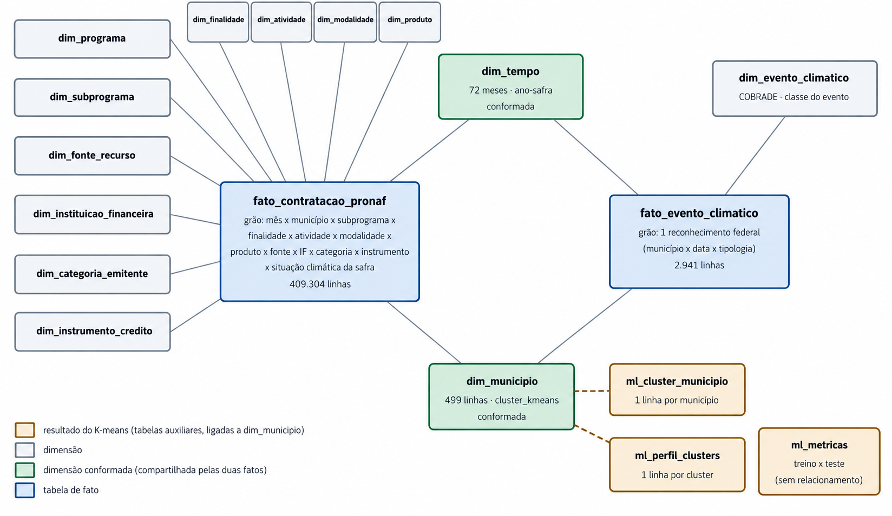

# Crédito Pronaf no Rio Grande do Sul: perfil de contratação, concentração municipal e efeito de eventos climáticos sobre a demanda por custeio

> **Projeto Integrado de Analytics**: Pós-graduação _Lato Sensu_ em Analytics e Business Intelligence
> Pontifícia Universidade Católica de Minas Gerais (PUC Minas) · Núcleo de Educação a Distância

**Autor(a):** Nadine Schenider

**Ano:** 2026

---

## 📌 Sobre o projeto

Solução completa de BI e analytics sobre o **crédito rural do Pronaf (Programa Nacional de Fortalecimento da Agricultura Familiar) no Rio Grande do Sul**, cruzando as operações contratadas (SICOR/Banco Central) com os reconhecimentos federais de desastres climáticos (Atlas Digital de Desastres/S2iD). O painel em Power BI responde a três perguntas: **onde, quando e em quê** o crédito é contratado, **como a contratação se comporta nas safras atingidas por estiagem e excesso hídrico**, e **quais perfis de município** existem para orientar a ação comercial.

- **Vertical:** Agronegócio / Governos
- **Área de negócio:** Gestão Financeira e Gestão Comercial (crédito)
- **Tipo de BI:** Departamental
- **Janela de análise:** jul/2019 a jun/2025 (safras 2019/2020 a 2024/2025, 72 meses)

### Objetivos

- Caracterizar o perfil da contratação do Pronaf no RS por safra, subprograma, finalidade, produto e instituição financeira.
- Medir a concentração do crédito por município (participação dos dez maiores).
- Comparar o comportamento da demanda por custeio em safras afetadas e não afetadas por eventos climáticos.
- Segmentar os municípios em perfis comerciais por clusterização (K-means), com avaliação em treino (80%) e teste (20%).
- Manter uma carga de dados automatizada e reexecutável, sem desenvolvimento adicional a cada atualização.

---

## 🔗 Links importantes

| Artefato                   | Link                                                                    |
| -------------------------- | ----------------------------------------------------------------------- | --- |
| 📄 Relatório Técnico (PDF) | `docs/relatorio_tecnico.pdf`                                            |     |
| 📊 Painel Power BI         | `dashboard/projeto_pronaf_formatado_ml.pbix` (e `.pbit` como modelo)    |
| 💾 Repositório             | [https://github.com/Nadine-Schneider/projetos-integrados-analytics-ABI] |

---

## 🗂️ Fontes de dados

| Fonte                                           | O que fornece                                                                                                                                                                                                                                   | Obtenção                                      |
| ----------------------------------------------- | ----------------------------------------------------------------------------------------------------------------------------------------------------------------------------------------------------------------------------------------------- | --------------------------------------------- |
| **SICOR / Banco Central**                       | Operações de crédito rural (arquivo anual por estado), complemento com o município IBGE, tabelas de domínio (programa, subprograma, fonte de recursos, instituições financeiras, categoria do emitente, instrumento de crédito, empreendimento) | Download automático (`bcb.gov.br/htms/sicor`) |
| **Atlas Digital de Desastres no Brasil (S2iD)** | Reconhecimentos federais de desastres no RS (tipologia COBRADE, danos humanos, prejuízos privados)                                                                                                                                              | Download automático via script                |
| **IBGE (API de localidades)**                   | Municípios do RS, mesorregião e regiões intermediária/imediata                                                                                                                                                                                  | Download automático                           |

- **Filtros aplicados na origem:** UF = RS, programa Pronaf, valor de crédito > 0, emissão entre 01/07/2019 e 30/06/2025.
- **Volume carregado:** 1.288.015 operações, somando R$ 73.849.715.583,98.
- **Privacidade:** dados públicos e agregados, sem identificação de beneficiários.

---

## 🧱 Arquitetura da solução

```
SICOR (BCB) ─┐
Atlas (S2iD) ─┼─►  Download incremental ─► ETL (Python) ─► Staging ─► Modelo dimensional ─► Power BI
IBGE ────────┘      (Node.js)                                         (CSV pt-BR + SQLite)    (importação)
                                                        K-means (execução única) ──────────────────▲
```

| Camada                     | Tecnologia                                                                           |
| -------------------------- | ------------------------------------------------------------------------------------ |
| Extração                   | Node.js 18+ (`01_download_sicor.js`, `01_download_atlas.mjs`, `01_download_ibge.js`) |
| Transformação e carga      | Python 3.10+ com pandas (`02_etl_pronaf_rs.py`)                                      |
| Armazenamento              | Arquivos CSV (`data/dw`) e SQLite (`dw_pronaf.db`)                                   |
| Machine Learning           | Python com scikit-learn (`03_ml_clusters.py`)                                        |
| Orquestração e agendamento | `00_pipeline.py` + Agendador de Tarefas do Windows                                   |
| Visualização               | Microsoft Power BI Desktop (modo importação)                                         |

---

## 🧮 Modelo dimensional

Modelo estrela (Kimball) com **2 tabelas de fato** e **13 dimensões** (12 na fato principal, atendendo ao mínimo de 10 dimensões e 24 meses de histórico).



**Fatos**

| Fato                      | Granularidade                                                                                                                                                                                                     | Principais medidas                                                                                                                                                                                   |
| ------------------------- | ----------------------------------------------------------------------------------------------------------------------------------------------------------------------------------------------------------------- | ---------------------------------------------------------------------------------------------------------------------------------------------------------------------------------------------------- |
| `fato_contratacao_pronaf` | Mês × município × subprograma × fonte de recursos × instituição financeira × finalidade × atividade × modalidade × produto × categoria do emitente (agregado mensal, para atender ao tempo de resposta do painel) | `qtde_contratos`, `valor_contratado`, `area_financiada_ha`, `vl_taxa_ponderada` (soma de taxa × valor), `flag_safra_afetada`, `tipo_evento_safra`                                                    |
| `fato_evento_climatico`   | 1 reconhecimento federal de desastre (município × data × tipologia): 2.941 linhas                                                                                                                                 | `qtde_reconhecimentos`, `prejuizo_agricultura`, `prejuizo_pecuaria`, `prejuizo_privado_total`, `afetados_seca`, `danos_humanos` (semiaditivas) e dimensões degeneradas `protocolo`, `data`, `status` |

**Dimensões**

| #   | Dimensão                     | Observação                                                     |
| --- | ---------------------------- | -------------------------------------------------------------- |
| 1   | `dim_tempo`                  | 72 meses, com ano-safra (julho a junho). Conformada            |
| 2   | `dim_municipio`              | 499 linhas, com regiões do IBGE e `cluster_kmeans`. Conformada |
| 3   | `dim_programa`               | Programa do crédito rural                                      |
| 4   | `dim_subprograma`            | Subprogramas do Pronaf                                         |
| 5   | `dim_fonte_recurso`          | Fonte de recursos                                              |
| 6   | `dim_instituicao_financeira` | Instituição financeira (CNPJ)                                  |
| 7   | `dim_categoria_emitente`     | Categoria do emitente                                          |
| 8   | `dim_instrumento_credito`    | Instrumento de crédito                                         |
| 9   | `dim_finalidade`             | Custeio, investimento, comercialização                         |
| 10  | `dim_atividade`              | Agrícola / pecuária                                            |
| 11  | `dim_modalidade`             | Modalidade do empreendimento                                   |
| 12  | `dim_produto`                | Produto/cultura financiada                                     |
| 13  | `dim_evento_climatico`       | Tipologia COBRADE (somente na fato de eventos)                 |

As duas fatos se conectam por dimensões conformadas (`dim_tempo` e `dim_municipio`), o que permite cruzar crédito e clima.

---

## ⚙️ Processo de ETL e automação (RF-01)

A carga é feita por um orquestrador (`00_pipeline.py`) chamado por um agendador:

```
Agendador do Windows ─► executar_pipeline.bat ─► 00_pipeline.py
  1. sicor_base     baixa só os arquivos 2019–2025 ausentes (na prática, só na 1ª carga)
  2. sicor_recente  rebaixa o(s) arquivo(s) anual(is) dos ÚLTIMOS 3 MESES + complemento + domínios
  3. atlas          só se data/raw/atlas_digital estiver vazia
  4. ibge           só se data/raw/ibge estiver vazia
  5. etl            staging → dimensões → fatos → data/dw/*.csv → dw_pronaf.db
```

- **Download incremental:** o Bacen não publica arquivos mensais, ele reescreve o arquivo do ano corrente; por isso os "últimos 3 meses" são obtidos rebaixando o arquivo anual (janela configurável com `--meses N`).
- **Tratamento:** leitura em lotes, detecção de encoding e separador, decimal com vírgula, normalização das chaves com zeros à esquerda, descarte de operações sem data ou sem valor positivo.
- **Controles:** trava contra execuções simultâneas, retentativas nos downloads, log por execução (`data/logs`) e código de saída para o agendador.
- **Agendamento:** tarefa **"Pronaf RS - Carga automatizada"**, **quinzenal, domingo às 02:00**, criada por `agendar_pipeline.ps1` (que também testa, consulta e remove a tarefa).
- **Machine Learning fora da carga:** o K-means é treinado **uma única vez** (`03_ml_clusters.py`) e o ETL apenas relê o resultado.

---

## 📊 Dashboard

Painel em Power BI com **6 abas** integradas e filtros globais por safra, município, subprograma, finalidade, produto e safra afetada.

| Aba                     | Conteúdo                                                                                                                                                                                                                                                                                                |
| ----------------------- | ------------------------------------------------------------------------------------------------------------------------------------------------------------------------------------------------------------------------------------------------------------------------------------------------------- |
| **Visão estratégica**   | 10 indicadores: valor contratado, quantidade de contratos, ticket médio, variação vs. safra anterior, % custeio, taxa de juros média ponderada, área financiada, municípios atendidos, % concedido por cooperativas, % do valor sob evento climático; mapa de bolhas por município colorido por cluster |
| **Tático · Financeiro** | Evolução histórica mensal e por safra, mix por finalidade, produto e subprograma, concentração por município                                                                                                                                                                                            |
| **Tático · Climático**  | Reconhecimentos de seca e excesso hídrico por safra, custeio nas safras afetadas, razão de ticket médio                                                                                                                                                                                                 |
| **Machine Learning**    | Métricas treino × teste, dispersão PCA dos clusters, distribuição dos municípios por cluster                                                                                                                                                                                                            |
| **Operacional**         | Tabelas de detalhamento: municípios, matriz subprograma × safra e instituições financeiras                                                                                                                                                                                                              |
| **Metadados**           | Dicionário de todas as medidas (regra de cálculo, fonte, observação), escopo, limitações e registro da homologação (RNF-02)                                                                                                                                                                             |

Os dados são consumidos em modo importação, sobre tabelas consolidadas, para manter as telas dentro do limite de tempo de resposta do regulamento.

---

## 🤖 Análise avançada: segmentação de municípios (K-means)

- **Técnica:** K-means (k = 5) sobre 9 atributos por município (perfil de crédito e exposição climática). Ticket médio e prejuízo por contrato passam por logaritmo e todos são padronizados. Nenhuma variável geográfica é usada.
- **Base:** 463 municípios elegíveis (32 municípios com menos de 100 contratos foram excluídos).
- **Protocolo:** 80% treino (370) e 20% teste (93), estratificado por região intermediária, com semente fixa.
- **Escolha de k:** silhueta praticamente plana entre k = 3 (0,271), k = 5 (0,263) e k = 6 (0,272). Manteve-se k = 5 por parcimônia e legibilidade comercial.

| Métrica                                 | Treino | Teste                           |
| --------------------------------------- | ------ | ------------------------------- |
| Coeficiente de silhueta                 | 0,263  | 0,207                           |
| Distância média ao centróide            | 2,078  | 2,193                           |
| Razão de distância teste/treino         | —      | 1,06 (sem sinal de sobreajuste) |
| Concordância com o modelo de referência | —      | 61,3%                           |
| Índice de Rand ajustado (ARI)           | —      | 0,429                           |

Os grupos formados coincidem com regiões produtivas conhecidas do estado (Serra, Vale do Taquari, Centro/Missões, Norte e Noroeste graneleiros), mesmo sem informação de localização no modelo.

---

## ✅ Homologação

Três medidas do painel foram conferidas manualmente contra os CSVs da carga, com registro por captura de tela (item 5 do relatório):

| Teste | Medida no painel                  | Conferência na fonte                                                             | Valor                |
| ----- | --------------------------------- | -------------------------------------------------------------------------------- | -------------------- |
| H1    | Reconhecimentos                   | Linhas de `fato_evento_climatico.csv`                                            | 2.941                |
| H2    | Quantidade de Contratos           | Linhas de `operacoes_pronaf_rs.csv` (staging) e soma de `qtde_contratos` da fato | 1.288.015            |
| H3    | Valor Contratado, safra 2023/2024 | Soma de `valor_contratado` com `ano_mes` entre 202307 e 202406                   | R$ 15.483.437.068,26 |

Resultado: igualdade exata nos três testes.

---

## 💡 Principais achados

- **Mercado pulverizado:** os dez maiores municípios respondem por apenas 8,7% do valor contratado (HHI municipal ≈ 38), então segmentar por perfil rende mais do que segmentar por tamanho.
- **Sazonalidade forte:** julho e agosto concentram 39% do valor; abril a junho somam 18%.
- **Custeio sob estiagem:** a participação do custeio atinge o máximo nas safras 2021/2022 e 2022/2023 (72% e 71%), as estiagens mais disseminadas da série, e recua para 62–63% depois. A leitura é descritiva e não estabelece causalidade.
- **Concentração produtiva e de canal:** soja, bovinos e milho somam mais da metade do valor; cooperativas de crédito originam 54%, com o Sicredi à frente.
- **Segmentação em 5 perfis** de município com coerência geográfica.

| Safra     | Contratos | Valor contratado | % custeio |
| --------- | --------- | ---------------- | --------- |
| 2019/2020 | 196.235   | R$ 7,56 bi       | 59%       |
| 2020/2021 | 200.846   | R$ 8,72 bi       | 65%       |
| 2021/2022 | 198.393   | R$ 10,88 bi      | 72%       |
| 2022/2023 | 228.680   | R$ 14,98 bi      | 71%       |
| 2023/2024 | 235.388   | R$ 15,48 bi      | 63%       |
| 2024/2025 | 228.473   | R$ 16,22 bi      | 62%       |

**Limitações:** análise descritiva (sem grupo de controle dentro de uma mesma safra); parte das operações não tem município identificado; o Atlas cobre os reconhecimentos até 2025; janela de análise fixa (jul/2019 a jun/2025).

---

## 🚀 Como executar

### Pré-requisitos

- Windows, Node.js 18+ e Python 3.10+ no PATH
- Power BI Desktop
- `pip install pandas openpyxl requests scikit-learn matplotlib`

### Passo a passo

```bash
# 1. Clonar o repositório
git clone https://github.com/[usuario]/[repositorio].git

# 2. Ajustar a raiz do projeto em scripts/executar_pipeline.bat (variável PRONAF_RAIZ)

# 3. Primeira carga: download + ETL
cd scripts
python 00_pipeline.py

# 4. Treinar o modelo de ML (execução única)
python 03_ml_clusters.py            # use --refazer apenas se quiser treinar de novo

# 5. Rodar o ETL de novo para gravar o cluster em dim_municipio
python 00_pipeline.py --so etl

# 6. Abrir o painel e clicar em Página Inicial → Atualizar
#    dashboard/projeto_pronaf_formatado_ml.pbix
```

Opções úteis do orquestrador: `--dry-run`, `--so <etapa>`, `--sem-download`, `--forcar`, `--meses N`.

### Agendamento automático

```powershell
.\agendar_pipeline.ps1                 # cria a tarefa (quinzenal, domingo, 02:00)
.\agendar_pipeline.ps1 -Status         # consulta a tarefa e a próxima execução
```

A tarefa aparece no **Agendador de Tarefas** do Windows como "Pronaf RS - Carga automatizada".

---

## 📁 Estrutura do repositório

```
.
├─ scripts/
│   ├─ 00_pipeline.py            # orquestrador (download incremental + ETL)
│   ├─ executar_pipeline.bat     # ponto de entrada do agendador
│   ├─ agendar_pipeline.ps1      # cria/testa/consulta/remove a tarefa agendada
│   ├─ 01_download_sicor.js
│   ├─ 01_download_atlas.mjs
│   ├─ 01_download_ibge.js
│   ├─ 02_etl_pronaf_rs.py       # transformação e carga (CSV + SQLite)
│   └─ 03_ml_clusters.py         # K-means, treino 80% / teste 20% (execução única)
├─ data/                         # gerado pelos scripts (raw, staging, dw, ml, logs)
├─ dashboard/                    # projeto_pronaf_formatado_ml.pbix / .pbit
├─ docs/                         # relatório técnico (PDF) e imagens
└─ README.md
```

---

## 📋 Atendimento aos requisitos

| ID     | Requisito                 | Como foi atendido                                                                               |
| ------ | ------------------------- | ----------------------------------------------------------------------------------------------- |
| RF-01  | ETL automatizado          | `00_pipeline.py` + tarefa agendada quinzenal; reexecução sem procedimento adicional             |
| RF-02  | Dashboard com 3 níveis    | Estratégico (10 indicadores), tático (gráficos de evolução histórica) e operacional (3 tabelas) |
| RF-03  | 10+ tipos de visualização | Cartões, mapa, linhas, colunas, dispersão, tabelas, matriz, entre outros                        |
| RF-04  | Aprendizado de máquina    | K-means (k = 5) com treino 80% / teste 20%                                                      |
| RF-05  | Filtros integrados        | Segmentações aplicadas às abas, refletindo em todos os visuais                                  |
| RNF-01 | Desempenho ≤ 10 s         | Grão agregado mensal e importação no Power BI                                                   |
| RNF-02 | Documentação das análises | Aba **Metadados** com regra de cálculo de cada medida                                           |
| RT-01  | 10 dimensões e 24 meses   | 12 dimensões na fato principal e 72 meses de histórico                                          |

---

## 📚 Referências

- BANCO CENTRAL DO BRASIL. **Matriz de Dados do Crédito Rural (MDCR) e microdados do SICOR.** Brasília: BCB.
- MINISTÉRIO DA INTEGRAÇÃO E DO DESENVOLVIMENTO REGIONAL. **Atlas Digital de Desastres no Brasil (S2iD).** Brasília: MIDR.
- IBGE. **API de localidades.** Rio de Janeiro: IBGE.
- KIMBALL, Ralph; ROSS, Margy. **The Data Warehouse Toolkit.** Indianapolis: Wiley.

---

## 📝 Licença

Uso acadêmico. Observe os termos de uso dos dados abertos das fontes originais.
